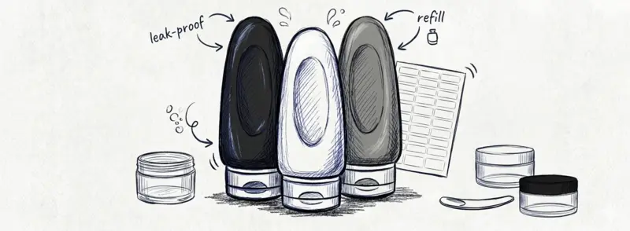
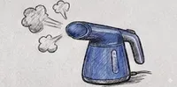

## The Convention Packing Checklist

Travel conventions can be stressful, but an organized bag makes a world of difference. These packing essentials help you maximize suitcase space and keep your dance clothes looking their best. Before heading to the airport, generate your [WCS competition travel checklist](/wcs-navigator) and browse our [curated gear essentials](/gear).

## Smart Packing Strategies

Navigating a hotel weekend means packing for multiple scenarios: daytime workshop schedules, evening competitions, and late-night socials. To minimize suitcase volume, prioritize wrinkle-resistant fabrics. For your competition attire, a compact travel garment bag keeps your lines crisp. Pack the invisible essentials: hydration multipliers for your water bottle and high-fidelity earplugs for late-night jam circles — the full item checklist is [The WCS Travel Pack](/blog/2026-04-19-practical-tools-essentials).

### Space-Saving Organization
Standard folding often leaves gaps in your luggage. Instead, try the "bundle" method or use high-quality compression cubes. These cubes allow you to group outfits by day or performance type, making it easy to find exactly what you need while keeping the rest packed. If you are preparing footwear for event ballrooms, see our [DIY suede dance shoe modification guide](/blog/2026-04-18-make-shoe-dance).

<notice type="affiliate" id="compression-cubes"></notice>

### Travel-Sized Essentials
Decant into leak-proof silicone containers that meet TSA regulations. Labeling each bottle ensures you won't mix up your hair gel with your face wash during a quick costume change. Learn how to [combat dance shoe odor with electric dryers](/blog/2026-06-01-shoe-care-modification) during multi-day weekend events.

<notice type="affiliate" id="travel-bottles"></notice>

## Maintaining Your Performance Gear

### Wrinkle-Free Outfits
A portable garment steamer fits in your bag and freshens shirts and dresses in minutes — arrive wrinkle-free.

<notice type="affiliate" id="portable-steamer"></notice>

### Steaming vs. Folding
| Care Method | Best For | Considerations |
| :--- | :--- | :--- |
| **Steaming** | Delicate fabrics, competition wear | Requires bringing a portable steamer |
| **Folding** | Practice wear, casual outfits | Use compression cubes to minimize wrinkles |

<Notice type="related">
For the full weekend playbook beyond packing, see the [Ultimate West Coast Swing Event Survival Guide](/blog/2026-06-15-ultimate-wcs-event-survival-guide).
</Notice>
