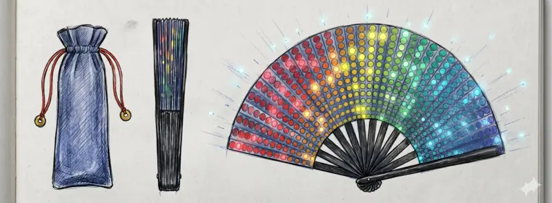

Whether you're heading to a local social or traveling across the country for a convention, these items are high-priority essentials for any West Coast Swing dancer. Browse our [essential West Coast Swing gear collection](/gear).

### Stay Cool on the Floor
Crowded dance floors can get incredibly hot. A large folding fan cools you down (and your partners) between songs.

<notice type="affiliate" id="rave-fan" />

### Protect Your Hearing
Ballroom sound systems are often cranked up to high volumes. High-fidelity earplugs let you enjoy the music at full volume and wake up without ringing ears. They lower the decibels while preserving the clarity of the music and conversation.

<notice type="affiliate" id="loop-experience" />

### Last Minute Checklist
* Extra socks
* Blister kit / bandaids
* Mints or gum
* Deodorant
* Refillable water bottle

For a full breakdown of out-of-town preparation, read our [WCS competition travel checklist](/blog/2026-06-01-event-travel-packing) and our [DIY suede dance shoe modification guide](/blog/2026-04-18-make-shoe-dance).
