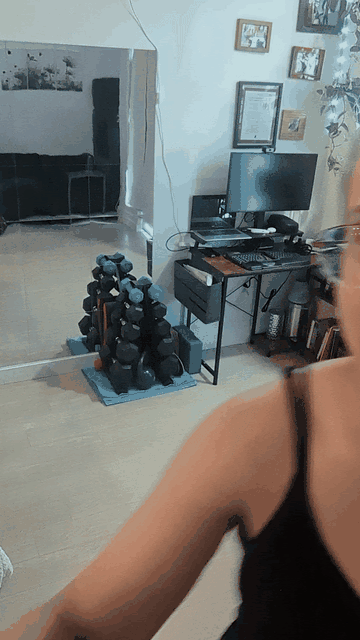
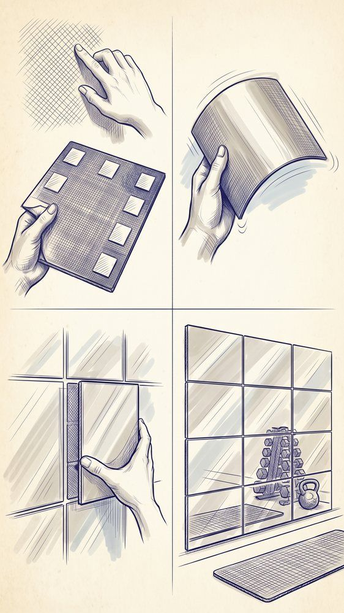

Practicing West Coast Swing at home usually means dodging furniture and guessing what your footwork actually looks like. I finally decided to upgrade my home office and workout space into a proper practice area, and the secret turned out to be surprisingly simple: stick-on mirrors.

I picked up a pack of 20 mirror panels from Amazon ([you can find the exact ones here](/gear/2026-06-20-stick-on-mirrors)), and they completely transformed the room. For drilling basics or checking styling, these beat an expensive studio mirror.

### Why These Mirrors Work for Home Studios

The biggest hurdle with installing large mirrors is usually the mounting process, especially if you want to protect your drywall. These panels bypass that completely. They are incredibly lightweight and mount with adhesive alone — no drilling, no anchors, no holes in your drywall. The installation and removal process is fast and entirely drywall-safe, making it a solid setup for any home practice space.

### Shatterproof and Versatile

Shatterproof, so you can practice right next to your desk and dumbbell rack — an accidental collision is a bump, not a disaster. The pack of 20 panels gave me plenty of coverage to see my full body for dance drills, and I even had a few left over that I used to line the inside of my cabinet.

Having a dedicated visual feedback setup makes a clear difference in how efficiently you can practice away from the studio.
