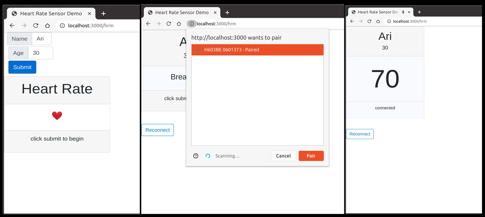

I do my workouts over Zoom with a personal trainer. He can't see my effort through the camera, so I built a dashboard that streams my heart rate to him in real time: [arii.github.io/hrm](https://arii.github.io/hrm/).

The hardware side is a chest strap. I use the Magene H64 — it speaks the standard Bluetooth Heart Rate Profile, which is all the dashboard needs. Any compliant monitor works (Polar, Garmin, Wahoo), but the Magene costs a fraction of those.

<notice type="affiliate" id="magene-h64" />

The project started in 2020, when gyms closed and training moved online. I wanted my trainer to see my heart rate zones live, the way he'd read my face in person. The current version pairs the strap through Web Bluetooth, runs a Tabata timer synced to Spotify, and shows a trainer dashboard with everyone's zones.

The full architecture is here: [arii.github.io/devai/hrm-architecture](https://arii.github.io/devai/hrm-architecture/).

I open-sourced the dashboard — it's at [arii.github.io/hrm](https://arii.github.io/hrm/), and it works with any Bluetooth heart rate strap.
